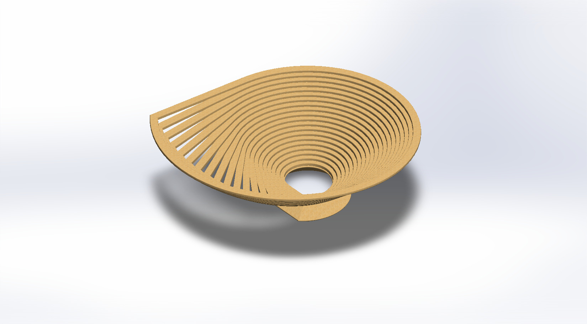
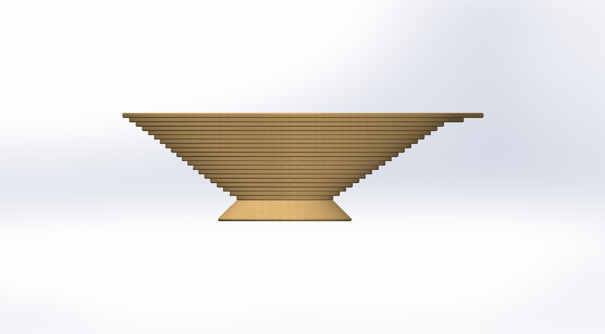
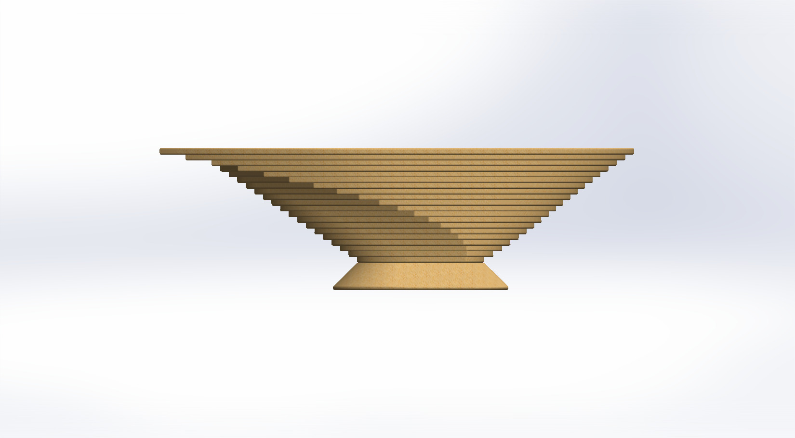
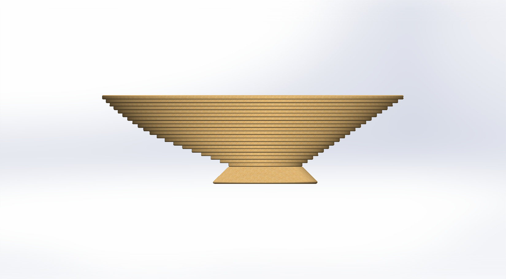
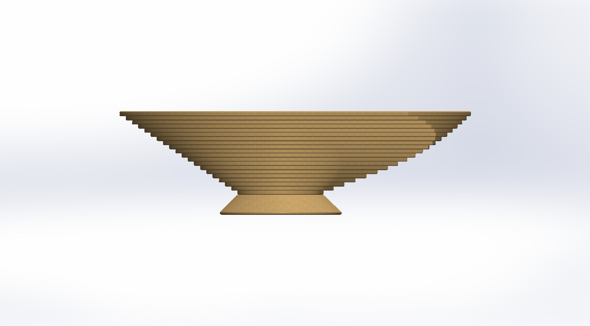
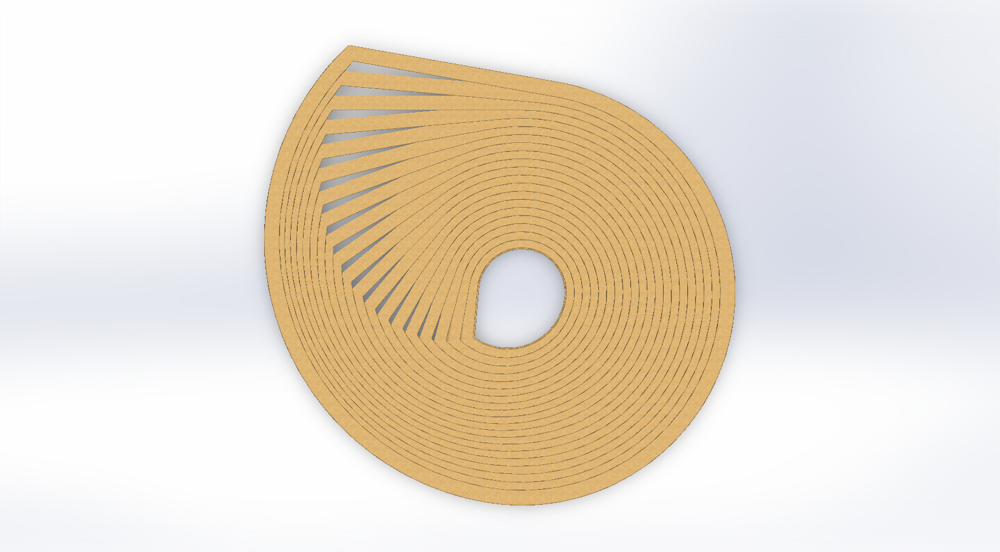
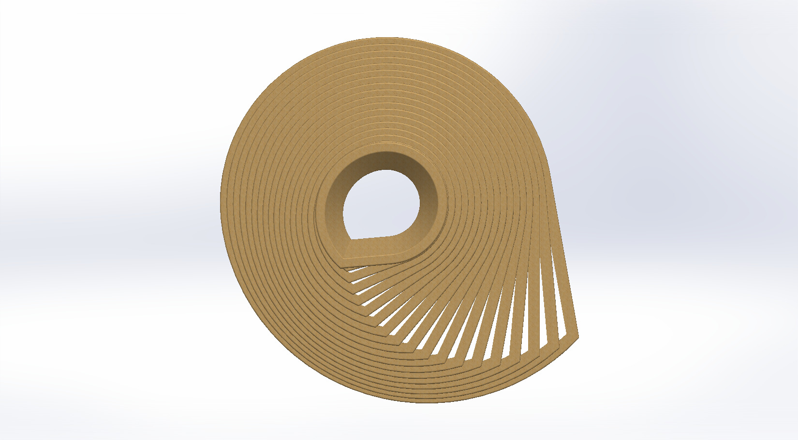
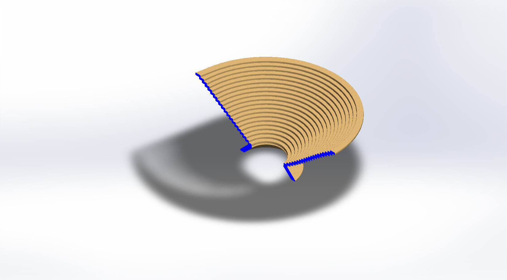
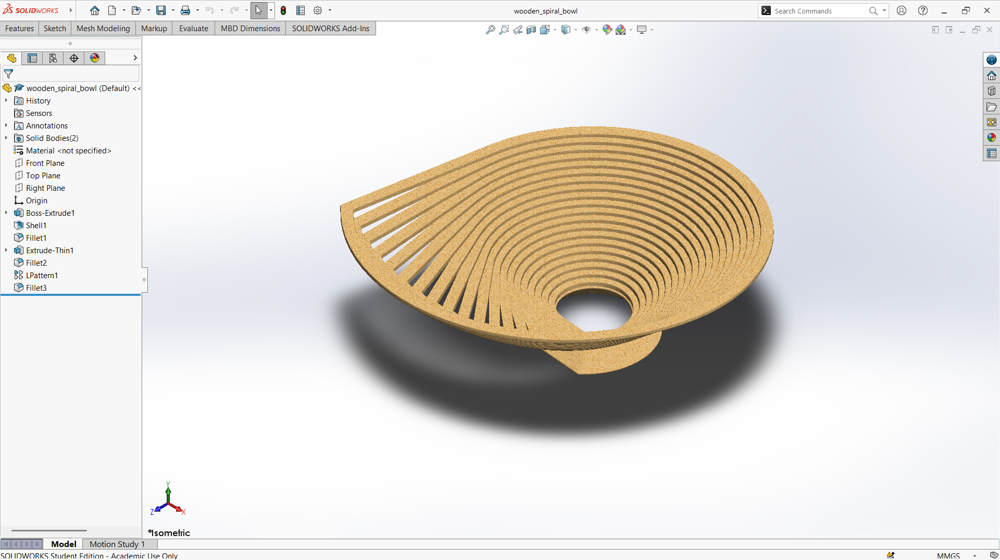

# A Spiral-Slatted Wooden Bowl Formed from Concentric Ribbons

## Summary

A bowl is a simple object, but its form can turn it into a piece of decoration as well as a container. Open, slatted forms in particular create a light structure that casts interesting shadows and lets air and light pass through. This project explores a wooden bowl built from a spiral arrangement of thin ribbons.

The model is a shallow, wide bowl made of many thin concentric ribbons with narrow gaps between them. The ribbons shift gradually around the bowl, and at one edge they fan out like the slats of a hand-held fan. The bowl narrows toward the center, where a round opening sits in the base. Together, these features give the bowl a layered, swirling look. The main challenge was to keep every ribbon evenly spaced while the overall shape curves and tapers, because a small error in one ribbon shows up across the whole bowl.

The bowl was developed as a computational model in SolidWorks. The views below show the ribbons, the gaps, and the central opening from every side, along with a section view of the part. This prototype is a base concept design that can be developed further into a bowl that can be cut or machined from wood.

---

## Computational Design

|   View    |                              Image                              |
| :-------: | :-------------------------------------------------------------: |
| Isometric |  |
|   Left    |            |
|   Right   |          |
|   Back    |            |
|   Front   |          |
|    Top    |              |
|  Bottom   |        |
|  Section  |      |

---

## Software Used

| Purpose |               Name                |
| :-----: | :-------------------------------: |
| Design  | SolidWorks 2024 (Student Version) |

---

## Tools Used

| No  |      Name      |
| :-: | :------------: |
| 01  |  Boss Extrude  |
| 02  |     Shell      |
| 03  |     Fillet     |
| 04  |  Extrude Thin  |
| 05  | Linear Pattern |

---

## Feature Tree

---

## Applications [^1]

- Fruit or Bread Serving
- Table Centerpiece
- Kitchen Counter or Mantel Decor
- Snack and Candy Serving
- Entryway Key Bowl

---

## Design Limitations

The design of the wooden spiral bowl was developed as a prototype product. That’s why the real-life design considerations, including wood species and grain direction, manufacturing method, food-safe finishing, durability, cleaning, proper design specification, monetization, and feasibility, have not been included.

---

## Future Improvements

The spiral form was modeled as a solid prototype, and the manufacturing method is not considered. The design should be adapted to a real process such as laser cutting, CNC machining, or wood turning, with the wall thickness and grain direction taken into account. A food-safe finish and the choice of wood species should also be specified. Weight, stability on a table, and cleaning access in the gaps of the spiral could also be evaluated through physical prototypes.

---

## Acknowledgements

Special thanks to the [EasyCAD Solutions](https://www.youtube.com/@EasyCADSolutions) YouTube channel for the SolidWorks tutorials that helped in creating this design.

---

## References

[^1]: [15'' Lasercut Wood Bowl](https://shop.nga.gov/15-lasercut-wood-bowl)
